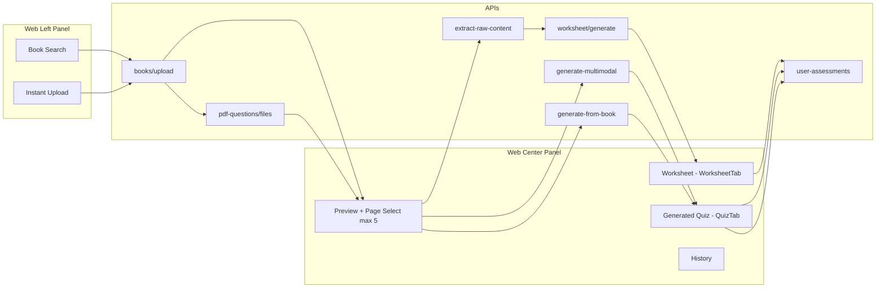

# Document Upload — Web vs Mobile Gap Analysis

**Source of truth:** `Quiz-React/src/components/HandwrittenWorkspace.tsx` (`/handwritten` route)  
**Mobile target:** `Eduvijna/src/screens/document-upload/*` + related services  
**Date:** June 19, 2026

---

## Executive Summary

The web **Document & Handwritten** workspace is a **single unified 3-panel UI** (library/upload | preview/quiz/worksheet/history | metadata + generate). Mobile currently has **three parallel, partially overlapping flows**:

| Mobile path | Closest web equivalent | Parity |
|-------------|------------------------|--------|
| `DocumentLibraryScreen` + `BookPageViewerScreen` | Web **Book Search** tab | ~70% |
| `DocumentUploadHomeScreen` + `DocumentUploadPreviewScreen` | Web **Instant Upload** tab | ~45% |
| `CreateDocumentQuizScreen` (via workspace Continue) | Legacy RAG flow (not in HandwrittenWorkspace) | Different API entirely |

To match web behavior, mobile should converge on **one entry point**, **server library as primary**, and fix **worksheet extraction**, **page thumbnails**, **save taxonomy**, and **metadata/difficulty mapping**.

---

## 1. Web Document Flow (HandwrittenWorkspace)

### 1.1 Layout

```
┌─────────────────────────────────────────────────────────────────┐
│  Mode switcher: AI | Document & Handwritten | Image | YouTube … │
├──────────────┬────────────────────────────┬─────────────────────┤
│ LEFT (300px) │ CENTER (flex)              │ RIGHT (280px)       │
│              │                            │                     │
│ book-search  │ preview | generated-quiz   │ Class / Subject     │
│ instant-     │ worksheet | history        │ Difficulty / Count  │
│ upload       │                            │ Generate Quiz       │
│              │ Thumbnails + page viewer   │ Generate Worksheet  │
│ Upload form  │ QuizTab / WorksheetTab     │ Generate Summary    │
│ Book list    │ History sections           │ Processing steps    │
└──────────────┴────────────────────────────┴─────────────────────┘
```

### 1.2 Two upload paths

#### Path A — Book Search (server library)

| Step | Action | API |
|------|--------|-----|
| 1 | Load filters | `GET /api/v1/study-materials/filters` |
| 2 | List books | `GET /api/v1/pdf-questions/files?source=Document` |
| 3 | Upload book | `POST /api/v1/study-materials/books/upload` (FormData: file, title, grade_level, subject, lesson_title, sub_lesson) |
| 4 | Search | Same list API with `search=` param |
| 5 | Select book | Client state; loads page thumbnails |
| 6 | Page images | `GET /api/v1/study-materials/books/{doc_id}/pages/{page}/image?size=mini\|full` (Bearer auth) |
| 7 | Select pages | Max **5 pages** (`MAX_QUIZ_PAGES`) |
| 8 | Generate quiz | `POST /api/v1/study-materials/generate-from-book` |
| 9 | Extract text (worksheet) | `POST /api/v1/study-materials/extract-raw-content` |
| 10 | Generate worksheet | `POST /api/v1/worksheet/generate` with `itext` = raw content |
| 11 | Save quiz | `POST /api/v1/user-assessments` — `assessment_type: 'web-quiz'`, `source: 'Document'` |
| 12 | Save worksheet | `source: 'Doc-Worksheet'` |
| 13 | Delete book | `DELETE /api/v1/study-materials/books/{docId}` |

#### Path B — Instant Upload (local staging)

| Step | Action | API |
|------|--------|-----|
| 1 | Drop/select files (PDF, images, etc.) | Local `File[]` state |
| 2 | Upload & Preview | Images → blob URLs; PDFs → `books/upload` per file for server page rendering |
| 3 | Select pages | Max **5 pages** (UI enforced) |
| 4 | Generate quiz | `POST /api/v1/assessment/generate-multimodal` — sends **all staged files** (page selection gates the button but is **not sent** in FormData) |
| 5 | Extract text (worksheet) | `POST /api/v1/assessment/extract-raw-content` (FormData: all files) |
| 6 | Generate worksheet | `POST /api/v1/worksheet/generate` with extracted `itext` |
| 7 | Save | Same as book path (`source: 'Document'` / `'Doc-Worksheet'`) |

> **Web note:** Instant upload UI says files are “not saved to library,” but PDF previews still hit `books/upload`. Images stay client-side only.

### 1.3 Additional web features (document mode)

| Feature | Implementation |
|---------|----------------|
| **History — Quiz** | `GET user-assessments?assessment_type=web-quiz&source=Document` |
| **History — Worksheet** | `GET user-assessments?source=Doc-Worksheet` |
| **Restore answers** | Popup if `responses` exist → `QuizTab` + `PUT .../responses` |
| **Explanation edit** | `PATCH .../questions/{idx}/explanation` |
| **Share quiz** | `ShareQuizPopup` → `POST /api/v1/sharequiz` |
| **Generate Summary** | `TopicSummaryModal` → `POST /api/v1/topicSummary` (metadata prompt, not file upload) |
| **Option shuffle** | `normalizeDocumentQuizQuestions(..., true)` on fresh generation |
| **Difficulty (quiz)** | `easy→'2'`, `medium→'mixed'`, `hard→'6'` |
| **Difficulty (worksheet)** | `Beginner` / `Advanced` / `Expert` |
| **Class/subject dropdowns** | `dropdownApi` — synced with school |
| **Tab persistence** | `localStorage` key `handwritten_workspace_tab_state_v1` |

### 1.4 Web related files

| File | Role |
|------|------|
| `HandwrittenWorkspace.tsx` | Main orchestrator (4,295 lines) |
| `services/userAssessmentService.ts` | Save/list/restore; `__WS_DATA__` worksheet encoding |
| `services/worksheetService.ts` | Worksheet API with `itext` |
| `services/dropdownApi.ts` | Class/subject dropdowns |
| `components/quiz/QuizTab.tsx` | Quiz player + response save |
| `components/worksheet/WorksheetTab.tsx` | Worksheet display + print |
| `components/GenerateWorksheetModal.tsx` | Question-type picker |
| `components/TopicSummary/*` | Summary generation UI |
| `utils/answerMappingUtils.ts` | Option shuffle/normalize |

**Not used by HandwrittenWorkspace (legacy elsewhere):**
- `POST /api/v1/rag/ingest-pdf` — `DocumentQuizPage.tsx`, `AddContentModal.tsx`
- `POST /api/v1/quiz/generate` with `file_name` — old document quiz page

---

## 2. Mobile Document Flow (Current State)

### 2.1 Three parallel paths

```
Entry points
├── Assessments tab → Document Upload chip → DocumentUploadHomeScreen
├── Home grid → AssessmentWorkspaceScreen (document mode)
│   ├── Source tiles → DocumentUploadHomeScreen
│   └── Continue → CreateDocumentQuizScreen (LEGACY)
└── ERP nav /document-upload → DocumentUploadHomeScreen
    ERP nav /document* → CreateDocumentQuizScreen → workspace redirect
```

### 2.2 Path A — Local module (`document-upload/`)

| Step | Screen | API / Storage |
|------|--------|---------------|
| 1 | `DocumentUploadHomeScreen` | Pick file/camera |
| 2 | Upload | `POST /api/v1/rag/ingest-pdf` (minimal metadata) |
| 3 | Save book | **AsyncStorage** `document_upload_module_books_v1` |
| 4 | Preview | `DocumentUploadPreviewScreen` — requires local `fileUri` |
| 5 | Page UI | **Fake thumbnails** (same image for every page) |
| 6 | Generate quiz | Re-upload `fileUri` → `POST /assessment/generate-multimodal` + `selected_pages` |
| 7 | Save quiz | `assessment_type: 'quiz'`, `source: 'DocumentUpload'` |
| 8 | Generate worksheet | `POST /worksheet/generate` — **no text extraction**, hardcoded Class 10/Document |
| 9 | Quiz screen | `DocumentUploadQuizScreen` wrapper |
| 10 | History | `DocumentUploadHistoryScreen` — local books + server assessments |

### 2.3 Path B — Server library (added in AI assessment parity work)

| Step | Screen | API |
|------|--------|-----|
| 1 | `DocumentLibraryScreen` | List, search, filter, upload, delete |
| 2 | `BookPageViewerScreen` | Page grid (numbered tiles, max 5), generate quiz/worksheet |
| 3 | Quiz | `POST /study-materials/generate-from-book` ✅ |
| 4 | Worksheet | Calls `extractRawContent` but **discards result** ❌ |
| 5 | Save | `source: 'DocumentUpload'` (should be `'Document'` / `'Doc-Worksheet'`) |
| 6 | Role gate | instructor/admin only |

### 2.4 Path C — Legacy (`CreateDocumentQuizScreen`)

| Step | API |
|------|-----|
| Upload file | `POST /rag/ingest-pdf` |
| Upload URL | `POST /rag/ingest-pdf` with `file_url` ✅ (only path with URL) |
| Generate quiz | `POST /quiz/generate` with `file_name` ❌ different from web |
| Storage | Separate AsyncStorage keys `uploadedFiles` / `uploadedUrls` |

---

## 3. Side-by-Side API Comparison

| Capability | Web (HandwrittenWorkspace) | Mobile (current) | Gap |
|------------|--------------------------|------------------|-----|
| Server book upload | `study-materials/books/upload` | ✅ Library screen | Local home still uses RAG only |
| List server books | `pdf-questions/files?source=Document` | ✅ Library screen | Not linked from home upload |
| Book filters | `study-materials/filters` | ✅ Library screen | — |
| Delete server book | `DELETE study-materials/books/:id` | ✅ Library screen | — |
| Page thumbnail images | `GET .../pages/{n}/image` | ❌ Number tiles only | **Critical UX gap** |
| Quiz from server book | `generate-from-book` + page_numbers | ✅ BookPageViewer | Save source wrong |
| Quiz from instant upload | `generate-multimodal` (all files) | ✅ Preview (re-upload + selected_pages) | Mobile actually sends pages; web instant does not |
| RAG ingest | Not used in workspace | ✅ Home screen | Different pipeline |
| Legacy quiz/generate | Not used in workspace | ✅ CreateDocumentQuizScreen | Should deprecate |
| URL / website upload | Via instant (PDF upload) / legacy | ❌ Home "Website URL" is a stub | **Missing** |
| Extract raw (book) | `study-materials/extract-raw-content` | ⚠️ Called but unused | **Broken worksheet** |
| Extract raw (instant) | `assessment/extract-raw-content` | ❌ Not implemented | **Missing** |
| Worksheet generate | With `itext` from extraction | ❌ No `itext` passed | **Broken worksheet** |
| Generate summary | `POST /topicSummary` | ❌ Not implemented | **Missing** |
| Save quiz type | `web-quiz` + `source: Document` | `quiz` + `source: DocumentUpload` | **History won't sync with web** |
| Save worksheet source | `Doc-Worksheet` | `DocumentUpload` | **Won't appear in web history** |
| Restore answers | Popup + QuizTab persistence | ✅ QuizTakingScreen (recent work) | Only if opened from Recent, not doc flow |
| Share quiz | ShareQuizPopup | ⚠️ Partial via QuizTakingScreen | Depends on path |
| Max page selection | 5 pages | Library: 5 ✅ / Preview: unlimited ❌ | Inconsistent |
| Difficulty medium (quiz) | `'mixed'` | `'4'` | **Payload mismatch** |
| Difficulty (worksheet) | Beginner/Advanced/Expert | easy/medium/hard strings | **Payload mismatch** |
| Class/subject dropdowns | Server dropdown API | Hardcoded / text inputs | **Missing dynamic dropdowns** |
| Option shuffle on generate | Yes | No | Minor |
| Unified 3-panel workspace | Yes | Split across 6+ screens | **UX architecture gap** |
| History in same screen | Yes (center History tab) | Separate History screen | UX difference |
| Processing step animation | Yes | Spinners only | UX difference |

---

## 4. Feature Gap Analysis (Detailed)

### 4.1 CRITICAL — Must fix for functional parity

#### G1. Worksheet generation ignores document content
**Web:** Extracts `raw_content` from selected pages → passes as `itext` to `worksheet/generate`.  
**Mobile:**
- `DocumentUploadPreviewScreen` — no extraction; hardcoded metadata.
- `BookPageViewerScreen` — calls `extractRawContent()` but **throws away the return value**.

**Fix:** Use extracted text as `itext` in `generateWorksheet()` for both paths.

---

#### G2. Save taxonomy doesn't match web
**Web saves:**
```json
{ "assessment_type": "web-quiz", "source": "Document" }
{ "assessment_type": "worksheet", "source": "Doc-Worksheet" }
```
**Mobile saves:**
```json
{ "assessment_type": "quiz", "source": "DocumentUpload" }
{ "assessment_type": "worksheet", "source": "DocumentUpload" }
```

**Impact:** Quizzes/worksheets created on mobile won't appear in web History tab (and vice versa if web uses different filters).

**Fix:** Align all document-upload saves to web values.

---

#### G3. Local upload doesn't use server library pipeline
**Web instant path:** PDFs go through `books/upload` for page rendering; library path persists books.  
**Mobile home path:** Uses `rag/ingest-pdf` → AsyncStorage only. Book never appears in server library or web.

**Fix:** After upload, call `uploadBookWithMetadata()` (or switch home upload entirely to server upload API). Store `docId` for generation without requiring fragile `fileUri`.

---

#### G4. No authenticated page image loading
**Web:** Fetches real page thumbnails/full images via Bearer-protected URL.  
**Mobile preview:** Reuses one `thumbnailUri` or Unsplash fallback for every page.

**Fix:** Implement `loadBookPageImage(docId, page, size)` in `documentUploadApi.ts` and use in Preview + Library + BookPageViewer.

---

#### G5. Website URL upload not implemented
**Web:** Instant upload accepts files; legacy web pages support URL.  
**Mobile home:** "Website URL" tile only switches to Search tab — **no functionality**.  
**Mobile legacy:** `CreateDocumentQuizScreen` supports URL via `rag/ingest-pdf` + `file_url`.

**Fix:** Add URL input modal → ingest with `file_url` OR upload flow matching web.

---

#### G6. Difficulty payload mismatch
| Level | Web quiz API | Mobile quiz API |
|-------|-------------|-----------------|
| easy | `'2'` | `'2'` ✅ |
| medium | `'mixed'` | `'4'` ❌ |
| hard | `'6'` | `'6'` ✅ |

**Fix:** Change mobile `toDifficultyPayload` medium → `'mixed'` to match web.

---

### 4.2 HIGH — Important for UX parity

#### G7. Three confusing entry points
Teachers can land in:
1. `DocumentUploadHomeScreen` (Assessments chip)
2. `AssessmentWorkspaceScreen` → Continue → `CreateDocumentQuizScreen`
3. `DocumentLibraryScreen` (banner only)

**Fix:** Single entry (`DocumentUploadHomeScreen` or unified workspace) with two clear tabs: **Library** | **Instant Upload** — mirroring web left panel.

---

#### G8. Page selection limit inconsistent
**Web:** Max 5 pages everywhere.  
**Mobile preview:** Unlimited selection.  
**Mobile library:** Max 5 ✅

**Fix:** Enforce `MAX_QUIZ_PAGES = 5` in preview screen.

---

#### G9. `fileUri` dependency breaks re-open
Preview quiz generation requires local `fileUri`. If cache cleared or user switches device, generation fails even when `docId` exists.

**Fix:** Prefer server `docId` + `generate-from-book` when available; use multimodal re-upload only as fallback.

---

#### G10. No Generate Summary
**Web:** `TopicSummaryModal` → `POST /topicSummary` from metadata + lesson context.  
**Mobile:** Not implemented anywhere in document-upload module.

**Fix:** Add summary action on preview/library screen (reuse web API).

---

#### G11. Class/subject from dropdown API
**Web:** Dynamic dropdowns from `/api/v1/dropdowns/classes` and `/subjects`.  
**Mobile preview/library:** Free-text or hardcoded `Class 10` / `Document`.

**Fix:** Wire `useDropdowns()` or equivalent into preview + book viewer metadata panels.

---

#### G12. Dual quiz result navigation
- Local module → `DocumentUploadQuizScreen` (`source: document-upload`)
- Library path → `QuizTakingScreen` (`source: document`)

**Fix:** Unify to one screen + one `source` value matching web (`document` or `history`).

---

### 4.3 MEDIUM — Polish / consistency

| Gap | Web | Mobile |
|-----|-----|--------|
| Option shuffle on fresh quiz | Yes | No |
| Processing step animation | 4-step pipeline UI | Spinner only |
| History in workspace | Center tab with Quiz/Worksheet/Summary sections | Separate `DocumentUploadHistoryScreen` |
| History summary section | Lists doc files (click no-op) | Not present |
| Delete from history | Supported | History ellipsis icon is decorative |
| Tab state persistence | localStorage | None |
| `uploadType` handwritten vs documents | UI-only on web | Not present |
| Worksheet difficulty labels | Beginner/Advanced/Expert | easy/medium/hard |
| Search fallback (empty search results) | Web retries unfiltered | Mobile: no fallback |

---

### 4.4 LOW — Legacy cleanup

| Item | Recommendation |
|------|----------------|
| `CreateDocumentQuizScreen` (~2800 lines) | Deprecate after parity; uses `/quiz/generate` not workspace APIs |
| `rag/ingest-pdf` in new module | Replace with `books/upload` |
| Two AsyncStorage keys for books | Merge to one or eliminate local storage in favor of server library |
| `AssessmentWorkspaceScreen` Continue → legacy | Route to unified document home instead |

---

## 5. Mobile Files — Current vs Needed

| File | Status | Needed changes |
|------|--------|----------------|
| `DocumentUploadHomeScreen.tsx` | Partial | Add Library/Instant tabs; fix URL tile; switch upload to server API |
| `DocumentUploadPreviewScreen.tsx` | Partial | Real page images; max 5 pages; extract raw for worksheet; dropdown metadata; save taxonomy |
| `DocumentLibraryScreen.tsx` | Good base | Link as primary tab; show in all entry paths |
| `BookPageViewerScreen.tsx` | Partial | Pass `itext` to worksheet; fix save source; page images optional upgrade |
| `DocumentUploadHistoryScreen.tsx` | Partial | Filter by `Document`/`Doc-Worksheet`; functional delete menu |
| `DocumentUploadQuizScreen.tsx` | Redundant? | Merge into QuizTakingScreen |
| `documentUploadApi.ts` | Partial | Add page image fetch; fix medium difficulty; add instant extract-raw-content |
| `documentUploadStorage.ts` | Local-only | Reduce reliance once server library is primary |
| `CreateDocumentQuizScreen.tsx` | Legacy | Deprecate |
| `AssessmentWorkspaceScreen.tsx` | Router | Point Continue to unified flow, not legacy |

---

## 6. Recommended Implementation Plan (Mobile)

### Phase 1 — Critical fixes (1–2 days)
1. Fix `toDifficultyPayload`: medium → `'mixed'`
2. Fix save taxonomy: `web-quiz`/`Document`, `worksheet`/`Doc-Worksheet`
3. Wire `extractRawContent` → `itext` in worksheet generation (Preview + BookPageViewer)
4. Enforce max 5 pages in Preview

### Phase 2 — Server library as primary (2–3 days)
5. Home upload → `uploadBookWithMetadata` instead of RAG-only
6. Preview generation → prefer `generate-from-book` when `docId` exists
7. Merge Library tab into Home (web left-panel parity)
8. Class/subject dropdowns on preview + viewer

### Phase 3 — Page images & instant upload (2–3 days)
9. Implement authenticated page image loading API helper
10. Real thumbnail strip in Preview + BookPageViewer
11. Instant upload path: multimodal without re-upload when possible
12. Website URL upload modal

### Phase 4 — History & workspace unification (1–2 days)
13. Single history filter matching web (`Document`, `Doc-Worksheet`)
14. Restore answers in document quiz flow (already in QuizTakingScreen — wire `assessmentId`)
15. Deprecate `CreateDocumentQuizScreen` entry from workspace Continue
16. One quiz result screen, one `source` convention

### Phase 5 — Nice-to-have (1–2 days)
17. Generate Summary (`topicSummary` API)
18. Processing step animation
19. Option shuffle on fresh generation
20. Share quiz from document flow

---

## 7. Web Flow Diagram (Reference)



---

## 8. Parity Confirmation Checklist

Use this after implementation to verify mobile matches web:

- [ ] Upload PDF with title/grade/subject/lesson → appears in server library (web + mobile)
- [ ] Search/filter books by grade and subject
- [ ] Delete book from library
- [ ] See real page thumbnails (not placeholder)
- [ ] Select max 5 pages
- [ ] Generate quiz from selected pages → questions appear
- [ ] Quiz saved as `web-quiz` / `Document` → visible in web History
- [ ] Generate worksheet from same pages → sections populated with document-based content
- [ ] Worksheet saved as `Doc-Worksheet` → visible in web History
- [ ] Open saved quiz from history → restore answers dialog works
- [ ] Upload image instant → preview → generate quiz
- [ ] Medium difficulty sends `'mixed'` to API
- [ ] Class/subject from school dropdowns, not hardcoded
- [ ] Single clear entry point (no legacy CreateDocumentQuizScreen for normal flow)

---

## 9. Summary Table

| Category | Web status | Mobile status |
|----------|-----------|---------------|
| Server book library | ✅ Full | ⚠️ Separate screen, not primary |
| Instant upload | ✅ Full | ⚠️ Local-only, fake previews |
| Page thumbnails | ✅ Auth image API | ❌ Placeholders |
| Quiz from book | ✅ | ✅ (library path only) |
| Quiz from instant | ✅ | ⚠️ Different API extras |
| Worksheet | ✅ With extraction | ❌ Broken (no itext) |
| Summary | ✅ | ❌ Missing |
| History sync | ✅ | ❌ Wrong source/type |
| URL upload | ⚠️ Legacy/instant | ❌ Stub UI |
| Unified workspace | ✅ One screen | ❌ 3 paths, 6+ screens |
| Restore answers | ✅ | ⚠️ Partial |

**Bottom line:** The **server library path** (`DocumentLibraryScreen` + `BookPageViewerScreen`) is the closest to web and should become the **primary** mobile experience. The **local preview path** needs the most work (page images, worksheet extraction, save taxonomy, server upload). The **legacy CreateDocumentQuizScreen** should be retired once parity is achieved.
